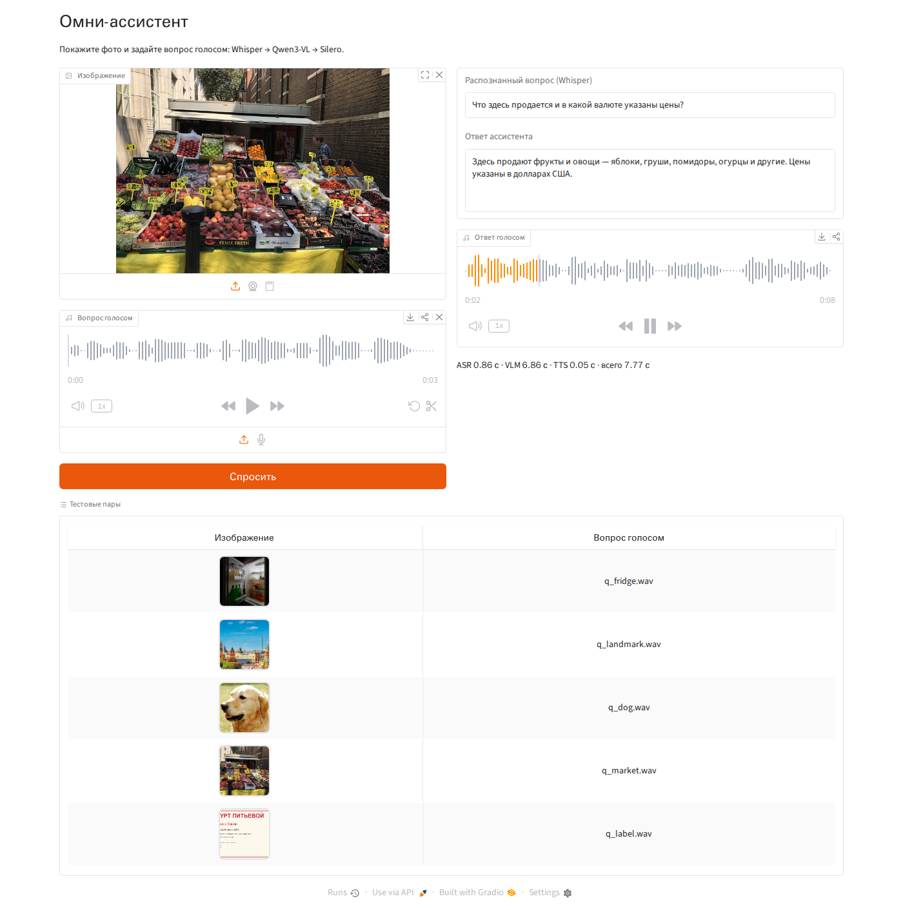
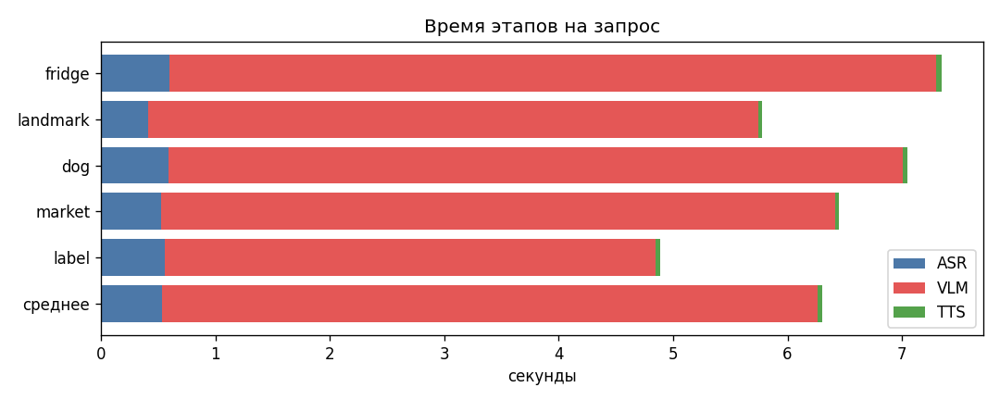
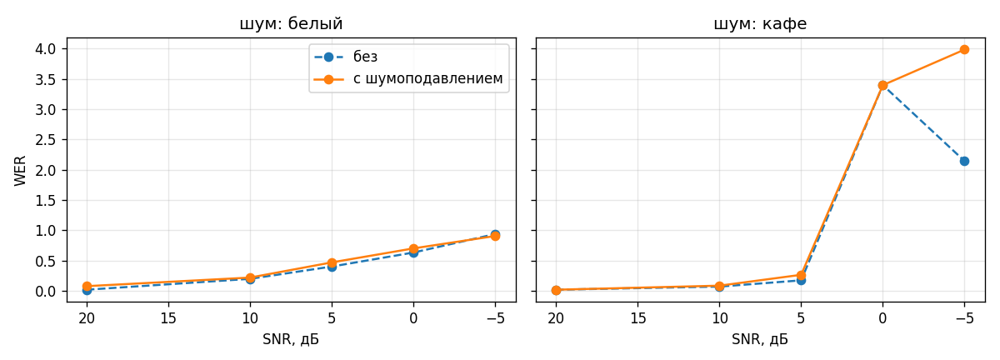
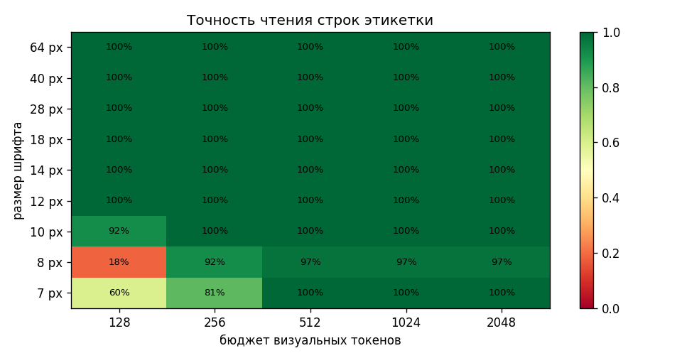

# Мультимодальный Omni-ассистент: Whisper → Qwen3-VL → Silero

Прототип голосового помощника: пользователь показывает фото и задаёт вопрос голосом, ассистент
отвечает голосом. Три модели (ASR, VLM, TTS) собраны в один пайплайн и помещаются на одну T4
(15 ГБ). Домашнее задание курса OTUS «LLM».

```
 аудио-вопрос ──► [ASR] Whisper small ──► текст вопроса ─┐
   (wav/mic)      + high-pass + noisereduce              ▼
 изображение ───────────────────────────────► [VLM] Qwen3-VL-8B-Instruct, 4-bit NF4
                                                         │  ответ ≤ 3 предложений
                                                         ▼
                              ответ-аудио ◄── [TTS] Silero v4_ru «kseniya» ◄── нормализация текста
```

## Ссылки для сдачи

| что | где |
| --- | --- |
| **Ноутбук** (все 27 ячеек кода выполнены в Colab на T4, выводы сохранены) | [`notebooks/omni_assistant.ipynb`](notebooks/omni_assistant.ipynb) |
| Открыть в Colab | [colab.research.google.com/…/omni_assistant.ipynb](https://colab.research.google.com/github/AlexIntellySoft/llm-8/blob/main/notebooks/omni_assistant.ipynb) |
| Скриншот интерфейса Gradio | [`outputs/gradio_screenshot.png`](outputs/gradio_screenshot.png) |
| Таблица latency | [`outputs/latency.csv`](outputs/latency.csv), [`outputs/latency.png`](outputs/latency.png) |
| Аудио-ответы ассистента | [`outputs/answers/`](outputs/answers/) |
| Шум → WER | [`outputs/asr_noise.csv`](outputs/asr_noise.csv), [`outputs/asr_noise.png`](outputs/asr_noise.png) |
| Мелкий текст → точность | [`outputs/ocr_detail.csv`](outputs/ocr_detail.csv), [`outputs/ocr_detail.png`](outputs/ocr_detail.png) |
| Сводка чисел | [`outputs/summary.json`](outputs/summary.json) |
| Карта «требование → где смотреть» | [`ДЛЯ_ПРОВЕРЯЮЩЕГО.md`](ДЛЯ_ПРОВЕРЯЮЩЕГО.md) |

## Что сделано

### 1. Среда и тестовые данные

* Colab, T4 15 ГБ. Версии библиотек закреплены в `requirements.txt` (те же `transformers` /
  `accelerate` / `bitsandbytes`, что работали в llm-7).
* **5 пар «изображение + аудио-вопрос»** (`data/pairs.json`):

| пара | изображение | вопрос голосом | что проверяет |
| --- | --- | --- | --- |
| `fridge` | открытый холодильник | «Что мне приготовить на ужин из того, что лежит в холодильнике?» | рассуждение по сцене |
| `landmark` | собор Василия Блаженного | «Где это находится и как называется это здание?» | знание мира |
| `dog` | золотистый ретривер | «Какой породы эта собака и подойдёт ли она для жизни в квартире?» | распознавание + совет |
| `market` | фруктовый лоток в Лондоне | «Что здесь продаётся и в какой валюте указаны цены?» | мелкие детали на фото (£ на ценниках) |
| `label` | синтетическая этикетка йогурта | «Какой срок годности у этого йогурта и сколько в нём сахара?» | чтение мелкого текста |

  Фото с Wikimedia Commons ([лицензии](data/images/LICENSES.md)). Этикетка нарисована скриптом:
  9 строк от 64 до 7 px с известным эталоном, на ней меряется «слепота». Вопросы озвучены голосом
  macOS Milena (`tools/make_test_data.py`). Голос намеренно не Silero, чтобы ASR не слушал
  собственный TTS. Там же 6 посторонних фраз, из которых собирается шум «кафе».

### 2. «Уши» и «Глаза»

* **ASR: Whisper small**, `language="ru"`, `temperature=0`. Перед распознаванием high-pass 80 Гц и
  спектральное шумоподавление `noisereduce`. Функция `transcribe(path) → str`, расширенная
  `asr_transcribe` дополнительно возвращает `no_speech_prob`, `avg_logprob` и флаг известных
  галлюцинаций Whisper («Продолжение следует…», «Субтитры сделал…»). По ним вопрос помечается как
  ненадёжный.
* **VLM: Qwen3-VL-8B-Instruct в 4-bit** (bitsandbytes NF4 + double quant, compute fp16 на T4).
  Изображение подаётся через `qwen_vl_utils.process_vision_info`, бюджет ≈1 Мп (≈1000 визуальных
  токенов по 32×32 px).
* **Промпт голосового ассистента**: по-русски, максимум 2–3 коротких предложения, без списков и
  markdown. Вопрос пришёл из ASR и может быть с ошибками, поэтому модели разрешено восстанавливать
  смысл по картинке. На пустой вопрос она описывает картинку и просит повторить. Поверх промпта
  стоит страховка `for_speech()`: убирает разметку и обрезает ответ до 3 предложений.

### 3. «Голос» и «Сердце»

* **TTS: Silero v4_ru**, голос `kseniya` (в ноутбуке есть сравнение всех пяти голосов).
  Silero не читает цифры и латиницу, поэтому `normalize_for_tts` переводит их в слова:
  «14.11.2026» → «четырнадцатого ноября две тысячи двадцать шестого года»,
  «2,5%» → «две целых пять десятых процентов», «£2» → «2 фунтов», латиница транслитерируется.
* **`run_omni_assistant(image, audio_query) → (текст, путь к wav)`**: ASR → VLM → TTS, каждый
  этап замеряется с `torch.cuda.synchronize()`. С `return_trace=True` дополнительно возвращает
  расшифровку, время этапов, число токенов и скорость генерации.
* **Бонус: стриминговый режим** `run_omni_streaming`. Qwen отдаёт токены через `TextIteratorStreamer`,
  каждое готовое предложение сразу уходит в Silero. Замеряется время до первого звука.

### 4. Gradio

Входы: изображение и аудио (загрузка файла или запись с микрофона). Выходы: текст ответа и плеер
с автовоспроизведением. Дополнительно показаны распознанный вопрос и время этапов. В Colab
приложение публикуется по ссылке `*.gradio.live`. Скриншот снимается автоматически headless-браузером
Playwright: он загружает пару, жмёт «Спросить» и ждёт ответ.

### 5. Анализ

* **Latency** (§7): время этапов на 5 парах × 3 повтора после прогрева, VRAM каждой модели,
  холодный старт, сравнение с режимом стриминга.
* **«Глухота»** (§8): к каждому вопросу подмешивается белый шум и шум «кафе» (чужая речь) при SNR
  20…−5 дБ, WER считается с шумоподавлением и без. Затем весь пайплайн прогоняется на зашумлённых
  вопросах и на аудио, где есть только шум: отвечает ли ассистент по делу и помогает ли защита от
  ненадёжного ASR.
* **«Слепота»** (§9): Qwen переписывает этикетку дословно при бюджете 128…2048 визуальных токенов,
  точность (1 − CER) считается по каждой строке. Получается карта «размер шрифта × разрешение».
  Плюс чтение ценников на реальном фото рынка.

## Результаты (Colab, Tesla T4, Qwen3-VL-8B-Instruct NF4)



### Ответы на тестовые пары

| пара | Whisper услышал | Qwen3-VL ответил | верно |
| --- | --- | --- | --- |
| fridge | что мне приготовить на ужин из того, что лежит в холодильнике. | Вот что можно приготовить: салат с помидорами, огурцами и оранжами, или просто овощи на гриле. Если хочешь — добавь немного мяса или рыбы. | да |
| landmark | где это находится и как называется это здание. | На фото — Красная площадь в Москве. Слева — Спасская башня Кремля, справа — Собор Василия Блаженного. | да |
| dog | Какой породы эта собака и подойдет ли она для жизни в квартире? | Это золотистый ретривер — очень добрый и умный пес. В квартире с ним можно, но нужно много времени на прогулки и внимание — он любит активную жизнь. | да |
| market | Что здесь продается и в какой валюте указаны цены? | Здесь продают фрукты и овощи — яблоки, груши, помидоры, огурцы и другие. Цены указаны в долларах США. | **нет**: на ценниках £ |
| label | Какой срок годности у этого **Игурты** и сколько в нем Сахара? | Срок годности до 14.11.2026. Сахар в нём — 11,0 грамм. | да |

Аудио-ответы: [`outputs/answers/answer_*.wav`](outputs/answers/).

### Latency (5 пар × 3 повтора, после прогрева)

| пара | ASR, с | VLM, с | TTS, с | **всего, с** | токенов картинки | токенов ответа |
| --- | --- | --- | --- | --- | --- | --- |
| fridge | 0.60 | 6.70 | 0.05 | **7.34** | 972 | 53 |
| landmark | 0.41 | 5.33 | 0.03 | **5.78** | 880 | 40 |
| dog | 0.59 | 6.42 | 0.04 | **7.05** | 950 | 51 |
| market | 0.52 | 5.89 | 0.04 | **6.45** | 972 | 44 |
| label | 0.56 | 4.29 | 0.03 | **4.88** | 504 | 34 |
| **среднее** | **0.54** | **5.72** | **0.04** | **6.30** | 856 | 44 |

* **Самый долгий этап — Qwen3-VL: 91% времени**, генерация 7,8 токена/с.
* Стриминг по предложениям: первый звук через **4,6 с** вместо 6,3 с.
* VRAM: Qwen 5,9 ГБ + Whisper 0,9 ГБ + Silero 0,03 ГБ, **пик 7,3 ГБ из 15**. Загрузка Qwen — 5 минут (скачивание 17,5 ГБ).



### «Глухота»: WER Whisper при шуме (с шумоподавлением)

| шум \ SNR | 20 дБ | 10 дБ | 5 дБ | 0 дБ | −5 дБ |
| --- | --- | --- | --- | --- | --- |
| белый | 8% | 22% | 47% | 70% | 91% |
| «кафе» (чужая речь) | 2% | 8% | 26% | **339%** | **398%** |

* На чистых вопросах WER 1,8%.
* При 0 дБ в кафе Whisper **зацикливается** («что ли, что ли, что ли…») или переписывает чужую фразу. Отсюда WER больше 100%.
* Шумоподавление `noisereduce` **не помогло**: на чужой речи без эффекта, на белом шуме WER даже чуть выше.
* Защита по уверенности ASR в 7 из 10 зашумлённых запросов заставила ассистента описать фото и попросить повторить, вместо ответа на выдуманный вопрос. Без защиты шум кафе превратился в ответ «Понял, ты хочешь сжимать — сейчас включусь».
* Дыра в защите: зацикленные расшифровки проходят как надёжные. Нужна проверка `compression_ratio`.



### «Слепота»: точность чтения этикетки

| шрифт \ визуальных токенов | 128 (448×256) | 256 | 512 | 1024 | 2048 |
| --- | --- | --- | --- | --- | --- |
| 12–64 px | 100% | 100% | 100% | 100% | 100% |
| 10 px | 92% | 100% | 100% | 100% | 100% |
| 8 px | **18%** | 92% | 97% | 97% | 97% |
| 7 px | 60% | 81% | 100% | 100% | 100% |

* Мелкий текст Qwen3-VL читает отлично, если пикселей хватает: от 512 токенов всё, вплоть до 7 px.
* При нехватке разрешения модель **не признаётся, а выдумывает**: «г. Таволга» вместо «г. Тверь», несуществующий сертификат, чужой номер ТУ.
* На реальном фото символ £ на ценниках **всегда** прочитан как $, а при перечислении цен модель зацикливается.



### Итог

Прототип работает на одной бесплатной T4 и отвечает верно на 4 из 5 вопросов. Для реального
использования 6 секунд ожидания слишком много, а поведение в шуме чужой речи непредсказуемо.
Главный рычаг — VLM (91% времени): vLLM/SGLang с AWQ/FP8 вместо bitsandbytes, модель полегче
для простых вопросов, более новая карта. Дальше — стриминг на всех этапах (VAD + потоковый ASR,
TTS по предложениям), VAD/выделение диктора вместо шумоподавления, режим чтения с высоким
разрешением и, в перспективе, end-to-end omni-модель. Подробно — §10 ноутбука.

## Как запустить

**Colab (основной путь):** открыть ноутбук по ссылке выше, выбрать *T4 GPU*, *Выполнить все*.
Ноутбук сам клонирует репозиторий, ставит зависимости, скачивает модели (≈7 ГБ) и в конце
скачивает `llm8_outputs.zip` с результатами. Сохранённый ноутбук с выводами
(*Файл → Скачать → .ipynb*) кладётся в `notebooks/omni_assistant.ipynb`, архив распаковывается в `outputs/`.

**Локально на Mac (проверка кода, без CUDA):** вместо 8B в 4-bit берётся Qwen3-VL-2B в bf16 на MPS,
эксперименты урезаны, результаты пишутся в `outputs_smoke/`.

```bash
python3.12 -m venv .venv && .venv/bin/pip install -r requirements.txt && .venv/bin/playwright install chromium
```

```bash
cd notebooks && OMNI_SMOKE=1 PYTORCH_ENABLE_MPS_FALLBACK=1 ../.venv/bin/jupyter nbconvert --to notebook --execute omni_assistant.ipynb --output omni_assistant_smoke.ipynb --ExecutePreprocessor.timeout=3600
```

**Пересобрать ноутбук / данные:** `.venv/bin/python -m tools.build_notebook`,
`.venv/bin/python -m tools.make_test_data` (нужен macOS: `say`, `afconvert`).

## Структура

```
data/
  images/        4 фото + синтетическая этикетка, LICENSES.md
  audio/         q_*.wav — вопросы, babble_*.wav — фразы для шума «кафе»
  pairs.json     пары, эталонные вопросы, ключевые слова ответа, эталон этикетки
notebooks/omni_assistant.ipynb   основной ноутбук
outputs/         результаты Colab-прогона: таблицы, графики, скриншот, аудио-ответы
tools/
  make_test_data.py   генерация этикетки и озвучка вопросов
  build_notebook.py   сборка ноутбука
```
